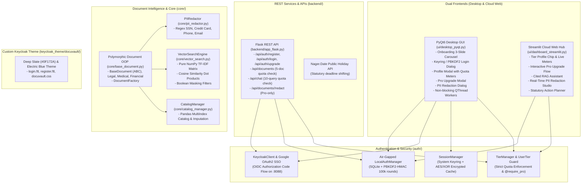

# 🗄️ DocuVaultAI

> **Multi-Tenant Cloud-Ready SaaS & Offline-First Hybrid Document Intelligence, Legal Verifier & Lifecycle Planner**  
> A production-grade, modular Python application engineered to strictly fulfill all requirements of the Advanced Python Curriculum across **Units 1 to 5**.

---

## 🌟 Executive Summary

**DocuVaultAI** is a modern, cloud-ready multi-tenant document intelligence and lifecycle platform featuring a **two-tier subscription model (`Free Trial` vs. `Pro / Upgraded Plan`)**. Built with an **offline-first, zero-knowledge architecture**, any user worldwide can register, authenticate, manage their documents, and upgrade their account without administrative role bottlenecks.

The application combines:
- **Unit 1 (OOP & GUI):** Abstract base classes, custom tier exception hierarchies, regular expression PII redaction, and a high-performance PyQt6 desktop interface (`QPropertyAnimation`, `QThread`, drag-and-drop, custom vector icons, zero invalid QSS cursor warnings).
- **Unit 2 (APIs & Security):** Keycloak OIDC authentication, Google OAuth2 SSO via system browser and local callback server (`http://localhost:8088/callback`), OS keyring credential persistence with machine-salted encrypted fallback, public holiday calculations, and `file_ops.log` audit logging.
- **Unit 3 (Web Frameworks):** Flask REST API microservices with tier quota enforcement (`/api/auth`, `/api/chat`, `/api/documents/<id>/redact`) and an interactive Streamlit Cloud Web Hub with dynamic tier gating and Matplotlib / Plotly visual analytics.
- **Unit 4 (Document Engineering):** Magic-byte binary verification (`%PDF`, `PK\x03\x04`, `<?xml`), SHA-256 chunked hashing, PyMuPDF page-by-page extraction, and Pandas MultiIndex catalog manager with data imputation.
- **Unit 5 (Mathematical Retrieval):** In-memory pure NumPy TF-IDF vector matrix computations, cosine similarity dot-product ranking, and boolean masking for cited anti-hallucination RAG answers.

---

## 💎 Two-Tier Subscription Model

DocuVault eliminates complex administrative hierarchies in favor of direct, self-service subscription tiers:

| Feature & Quota | 🆓 Free Trial Plan | ⚡ Pro / Upgraded Plan |
| :--- | :--- | :--- |
| **Document Storage Limit** | Up to **5 Documents** max | **Unlimited Documents & Folders** |
| **AI RAG Queries** | **10 Queries** per session | **Unlimited Queries & OCR** |
| **Storage Architecture** | Air-Gapped Local Vault (`vault/local`) | **Zero-Knowledge Cloud Sync & Web Hub** |
| **Legal Clause Smart Diff** | 🔒 Locked (Upgrade required) | **Full Document Version History & Visual Diff** |
| **Automated PII Redaction** | 🔒 Locked (Upgrade required) | **Regex PII Detection, Masking & Audit (SSN, Cards, Emails)** |
| **Calendar Expiry Export** | 🔒 Locked (Upgrade required) | **iCalendar (`.ics`) & Google Calendar Export** |
| **Desktop & Web Status** | `[FREE TIER]` Badge | `[PRO PLAN]` Radiant Blue Badge |

---

## 🏛️ System Architecture



---

## 🚀 Quickstart & Usage

### 1. Installation

Ensure Python 3.10+ (or Python 3.14) is installed. Install all project dependencies:

```bash
pip install -r requirements.txt
```

### 2. Launching the PyQt6 Desktop App

Launch the enterprise desktop application:

```bash
python run.py --desktop
```

- **First Launch Experience:** You will be greeted by the **3-Slide Animated Onboarding Carousel** highlighting offline security, cryptographic validation, and cited AI retrieval.
- **Authentication Gate:** The sleek **Sign In / Create Free Account** modal appears automatically. Sign in with existing credentials, register a new free account, or continue with Google SSO.
- **Remember Me:** Persistent session caching ensures seamless auto-login on subsequent runs via the Windows Credential Manager / system keyring.
- **Quota Warnings & Upgrade:** When a Free user ingests 5 documents or attempts to access PII Redaction, the **Pro Upgrade Modal** appears, providing feature comparisons and instant mock checkout.

### 3. Launching the Streamlit Cloud Web Hub

Start the interactive Streamlit analytics portal:

```bash
streamlit run ui/dashboard_streamlit.py
```
Or open the desktop app and click the **"🌐 Launch Web Hub"** button in the header.

### 4. Running the Flask REST API Backend

Start the Flask microservices backend:

```bash
python backend/app_flask.py
```

Endpoints include:
- `POST /api/auth/register` — Register worldwide accounts
- `POST /api/auth/login` — Authenticate via Keycloak or air-gapped local fallback
- `POST /api/auth/upgrade` — Instant elevation to Pro Plan
- `GET /api/auth/profile` — User profile and remaining quotas
- `POST /api/documents/upload` — Ingest document (enforcing 5-doc Free quota)
- `POST /api/chat` — Vector TF-IDF RAG query (enforcing 10-query Free quota)
- `POST /api/documents/<id>/redact` — Pro-only automated PII redaction

---

## 🧪 Comprehensive Automated Testing

The project includes 40 comprehensive unit and integration tests across all curriculum units and multi-tenant capabilities:

```bash
python -m unittest discover tests
```

### Test Coverage Highlights:
- **`tests/test_units.py` (22 tests):** OOP hierarchy, binary magic-byte validation, regex contract clauses, holiday deadline calculations, Flask REST services, Pandas MultiIndex catalog, pure NumPy TF-IDF matrix math.
- **`tests/test_phase1_auth_and_tiers.py` (10 tests):** Salted PBKDF2-HMAC hashing, offline Keycloak OIDC fallback, token caching, encrypted local session persistence, onboarding flags.
- **`tests/test_phase4_end_to_end.py` (8 tests):** Worldwide self-registration, instant Pro upgrades, regex PII redaction, Free vs. Pro quota enforcement, Flask REST tier error codes (403 Forbidden).

---

## 🎨 Enterprise Theme Tokens

DocuVault features tailored, distraction-free color tokens matching modern SaaS tools:

- **Deep Slate Canvas:** `#0F172A`
- **Obsidian Card Surface:** `#1E293B`
- **Accent Orange:** `#FF6422` (Light) / `#FF7A3D` (Dark)
- **Electric Blue (Pro):** `#2563EB`
- **Border Gray:** `#334155`
- **Verified Green:** `#10B981`
- **Alert Red:** `#EF4444`

---

## 📜 Curriculum Compliance Matrix (Units 1 - 5)

| Curriculum Unit | Core Module | Real Implementation in DocuVault |
| :--- | :--- | :--- |
| **Unit 1: OOP & GUI** | `core/base_document.py`, `ui/desktop_pyqt.py`, `core/pii_redactor.py` | `BaseDocument` ABC, `DocumentFactory`, `TierLimitExceededError`, `FeatureLockedError`, regex PII redaction, `QPropertyAnimation`, `QThread`. |
| **Unit 2: APIs & Security** | `auth/keycloak_client.py`, `auth/session_manager.py`, `backend/api_client.py` | OIDC password grant, Google OAuth2 callback on port 8088, keyring credential caching, Nager.Date holiday calculations, `file_ops.log`. |
| **Unit 3: Web Frameworks** | `backend/app_flask.py`, `ui/dashboard_streamlit.py` | Flask REST API with custom error handlers (403, 401, 400), Streamlit multi-tenant dashboard with live tier meters and PII studio. |
| **Unit 4: Parsers & Pandas** | `core/parsers/binary_parser.py`, `core/catalog_manager.py` | Magic-byte file validation (`%PDF`, `PK`, `<?xml`), SHA-256 chunked hashing, Pandas MultiIndex catalog with imputation. |
| **Unit 5: NumPy & Viz** | `core/vector_search.py` | Pure NumPy TF-IDF matrix, vectorized cosine dot products, boolean masking, Matplotlib similarity distribution charts. |
