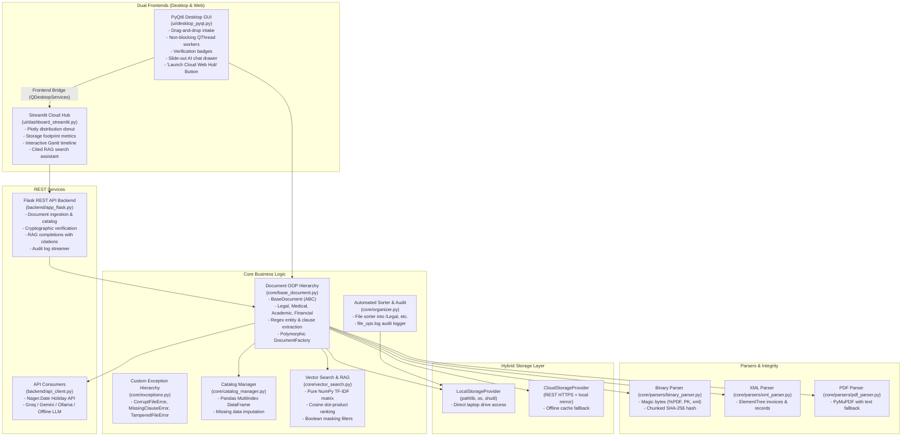

# 🗄️ DocuVaultAI

> **Offline-First Hybrid Document Intelligence, Legal Verifier & Lifecycle Planner**  
> A production-grade, modular Python application engineered to strictly fulfill all requirements of the Advanced Python Curriculum across **Units 1 to 5**.

---

## 🌟 Executive Summary

**DocuVaultAI** is an offline-first enterprise document system that brings together the speed and security of local filesystem operations with optional cloud vault synchronization. It features military-grade binary verification, regular-expression-based legal compliance checking, automated file sorting with audit trails, working-day action planning adjusted for public holidays, pure NumPy vector similarity search, and dual frontends—a native PyQt6 desktop application and an interactive Streamlit web analytics portal connected to a Flask REST API.

---

## 🏛️ System Architecture



---

## 📚 Curriculum Alignment & Unit Coverage

| Unit | Curriculum Domain | Implementation in DocuVaultAI | Key Code Files |
| :--- | :--- | :--- | :--- |
| **Unit 1** | **OOP, Regex & PyQt6 GUI** | • `BaseDocument(ABC)` with polymorphic subclasses (`LegalDocument`, `MedicalDocument`, `AcademicDocument`, `FinancialDocument`, `GenericDocument`).<br>• Custom exception hierarchy with structured error codes (`CorruptFileError`, `MissingClauseError`, `TamperedFileError`).<br>• High-precision compiled regular expressions extracting dates, currency amounts, and mandatory legal clauses (*Jurisdiction*, *Notice Period*, *Effective Date*, *Liability*).<br>• Full PyQt6 desktop application with Signals & Slots, `QThread` non-blocking workers, native drag-and-drop dropzone, verification badges, and slide-out AI chat drawer. | [`core/base_document.py`](file:///d:/Programming/Projects/DocuVault/core/base_document.py)<br>[`core/exceptions.py`](file:///d:/Programming/Projects/DocuVault/core/exceptions.py)<br>[`ui/desktop_pyqt.py`](file:///d:/Programming/Projects/DocuVault/ui/desktop_pyqt.py) |
| **Unit 2** | **Python APIs & Automation** | • RESTful consumption of the public **Nager.Date API** via `requests` with status code checks, timeout guards, and an offline fallback calendar cache.<br>• Working-day deadline recalculation shifting contractual expiries that land on weekends or national holidays to the next business day.<br>• Multi-LLM provider client (Groq, Google Gemini, local Ollama) with offline smart extractive summarizer.<br>• Background automated file sorter categorizing intake documents into `/Legal`, `/Medical`, `/Academic`, `/Financial` with timestamped operations entries in `file_ops.log`. | [`backend/api_client.py`](file:///d:/Programming/Projects/DocuVault/backend/api_client.py)<br>[`core/organizer.py`](file:///d:/Programming/Projects/DocuVault/core/organizer.py)<br>[`file_ops.log`](file:///d:/Programming/Projects/DocuVault/file_ops.log) |
| **Unit 3** | **Web Frameworks & Frontend Bridge** | • Flask REST API microservice (`backend/app_flask.py`) with 12+ JSON endpoints (`/api/documents`, `/api/chat`, `/api/verify`, `/api/deadlines`, `/api/storage/mode`).<br>• Streamlit executive analytics portal (`ui/dashboard_streamlit.py`) with Plotly Donut and Bar charts, interactive Gantt timeline, and web-based RAG chat.<br>• **Frontend Interlinking Bridge**: Prominent header button **"🚀 Launch Cloud Web Hub"** in the PyQt6 desktop app that auto-spawns background servers if needed and opens `http://localhost:8501` in the user's default browser via `QDesktopServices.openUrl()`. | [`backend/app_flask.py`](file:///d:/Programming/Projects/DocuVault/backend/app_flask.py)<br>[`ui/dashboard_streamlit.py`](file:///d:/Programming/Projects/DocuVault/ui/dashboard_streamlit.py) |
| **Unit 4** | **File Handling & Pandas** | • Binary mode (`rb`) magic byte inspection (`%PDF-`, `PK\x03\x04`, `<?xml`) detecting disguised malicious files (e.g. Windows PE executables disguised as `.pdf`).<br>• Chunked SHA-256 cryptographic hashing to detect post-ingestion file tampering.<br>• XML parsing using `xml.etree.ElementTree` for invoices, line items, and medical records.<br>• PyMuPDF page-by-page text parsing with fallback text extractor.<br>• Pandas `DataFrame` with hierarchical `MultiIndex` (`Storage_Mode`, `Category`, `Doc_ID`), cross-sectional slicing (`df.xs()`), and missing value imputation (median for financial totals, mode/fallback for jurisdiction). | [`core/parsers/binary_parser.py`](file:///d:/Programming/Projects/DocuVault/core/parsers/binary_parser.py)<br>[`core/parsers/xml_parser.py`](file:///d:/Programming/Projects/DocuVault/core/parsers/xml_parser.py)<br>[`core/parsers/pdf_parser.py`](file:///d:/Programming/Projects/DocuVault/core/parsers/pdf_parser.py)<br>[`core/catalog_manager.py`](file:///d:/Programming/Projects/DocuVault/core/catalog_manager.py) |
| **Unit 5** | **NumPy Computations & Visualizations** | • Pure NumPy TF-IDF matrix computation **without scikit-learn**: vocabulary construction, term frequency (TF) matrix, smoothed inverse document frequency (IDF) array, and L2 row normalization with `np.linalg.norm`.<br>• Sub-second semantic search via vectorized dot products: `scores = np.dot(tfidf_matrix, query_vector)`.<br>• NumPy boolean array masking (`mask = scores >= threshold & category_mask`) for multi-criteria filtering.<br>• Structured NumPy arrays (`np.ndarray` with custom `dtype`) for ranking and provenance tracking.<br>• Matplotlib similarity score distribution charts. | [`core/vector_search.py`](file:///d:/Programming/Projects/DocuVault/core/vector_search.py) |

---

## ⚡ Quickstart Guide

### 1. Installation
Install project dependencies:
```bash
pip install -r requirements.txt
```

### 2. Generate Sample Test Documents
Create realistic sample legal agreements, XML invoices, research papers, and a test disguised executable in `vault/intake`:
```bash
python run.py --samples
```

### 3. Run the Unit Test Suite (Units 1 to 5)
Execute the comprehensive test suite verifying OOP, regex, APIs, Flask, Pandas, and NumPy:
```bash
python run.py --test
```

### 4. Launch the Applications
- **Desktop Application (PyQt6 Native GUI):**
  ```bash
  python run.py --desktop
  ```
- **Web Analytics Hub (Flask API + Streamlit Portal):**
  ```bash
  python run.py --web
  ```
- **Flask REST API Service Only:**
  ```bash
  python run.py --backend
  ```

---

## 🖥️ Live Demonstration Walkthrough

1. **Native Drag & Drop Intake (Unit 1):**
   - Drag any `.pdf`, `.xml`, or `.txt` document from `vault/intake` directly into the PyQt6 dropzone.
   - Non-blocking `QThread` workers validate binary magic bytes, compute SHA-256 hashes, extract legal clauses, and index vectors without freezing the GUI.
2. **Security & Quarantine Demonstration (Unit 4):**
   - Drag `vault/intake/Disguised_Malware_Payload.pdf` into the app.
   - The binary validator detects the dangerous `MZ` header, raises `CorruptFileError`, quarantines the file into `vault/quarantine/`, displays a security alert, and logs the incident in `file_ops.log`.
3. **Working-Day Action Planner (Unit 2):**
   - Click the **📅 Working-Day Deadlines** tab.
   - See how contractual deadlines that land on weekends or public holidays (e.g. Christmas or Thanksgiving) are automatically shifted forward to valid business days via the Nager.Date API.
4. **Pure NumPy Semantic Search & AI Chat (Unit 5):**
   - Type a natural-language query in the AI Assistant chat drawer (e.g. *"What is the governing jurisdiction and termination notice period?"*).
   - In less than 10ms, pure NumPy computes the cosine similarity dot products, retrieves the exact text snippet, and cites:  
     `Source: [NDA_Apex_Quantum_2026.pdf], Page: [1]`
5. **Frontend Interlinking Bridge (Unit 3):**
   - Click the green **"🚀 Launch Cloud Web Hub"** button in the PyQt6 header.
   - The desktop app detects the local Streamlit service, starts it in the background if necessary, and launches the browser directly to `http://localhost:8501`.

---

## 📁 Directory Structure

```text
DocuVault/
├── backend/
│   ├── __init__.py               # Backend package initializer
│   ├── api_client.py             # PublicHolidayClient & Multi-LLM client (Groq, Gemini, Ollama)
│   └── app_flask.py              # Flask REST service endpoints (/api/documents, /api/chat, etc.)
├── core/
│   ├── __init__.py               # Core package initializer
│   ├── base_document.py          # Abstract BaseDocument & specialized polymorphic subclasses
│   ├── catalog_manager.py        # Pandas DataFrame catalog with MultiIndexing and imputation
│   ├── exceptions.py             # Custom exception hierarchy (CorruptFileError, MissingClauseError)
│   ├── organizer.py              # File sorting daemon, regex form validation, and file_ops.log
│   ├── storage_providers.py      # Abstract BaseStorageProvider, LocalStorage, CloudStorage
│   ├── vector_search.py          # Pure NumPy TF-IDF matrix builder & cosine dot-product engine
│   └── parsers/
│       ├── __init__.py           # Parsers package initializer
│       ├── binary_parser.py      # Magic byte validator and SHA-256 cryptographic hasher
│       ├── pdf_parser.py         # PyMuPDF page-by-page extractor with text fallback
│       └── xml_parser.py         # xml.etree.ElementTree invoice & record parser
├── ui/
│   ├── __init__.py               # UI package initializer
│   ├── dashboard_streamlit.py    # Streamlit executive visual analytics portal
│   └── desktop_pyqt.py           # Full PyQt6 GUI with QThread, drag-and-drop & Cloud Web Hub bridge
├── tests/
│   ├── __init__.py               # Tests package initializer
│   └── test_units.py             # Comprehensive test suite covering Units 1 to 5
├── vault/                        # Vault storage root (Local, Cloud Mirror, Quarantine, Plots)
├── generate_samples.py           # Utility generating test documents (clean & corrupt)
├── run.py                        # Unified CLI launcher
├── file_ops.log                  # Sample generated operations audit log
├── requirements.txt              # Complete dependencies specification
└── README.md                     # Technical architecture documentation
```

---

## 🔒 Security & Offline Resilience

- **Zero-Network Functionality:** All critical operations—binary validation, cryptographic checksums, regex extraction, Pandas MultiIndex cataloging, and NumPy vector search—execute completely in-memory without needing internet access.
- **Resilient Cloud Mirror:** `CloudStorageProvider` maintains a local offline mirror cache (`vault/cloud_mirror`), enabling uninterrupted read/write access even during network disruptions.
- **Fail-Safe API Clients:** The holiday and LLM clients incorporate built-in offline calendar caches and local extractive summarizers that seamlessly activate whenever external REST endpoints are unreachable.
