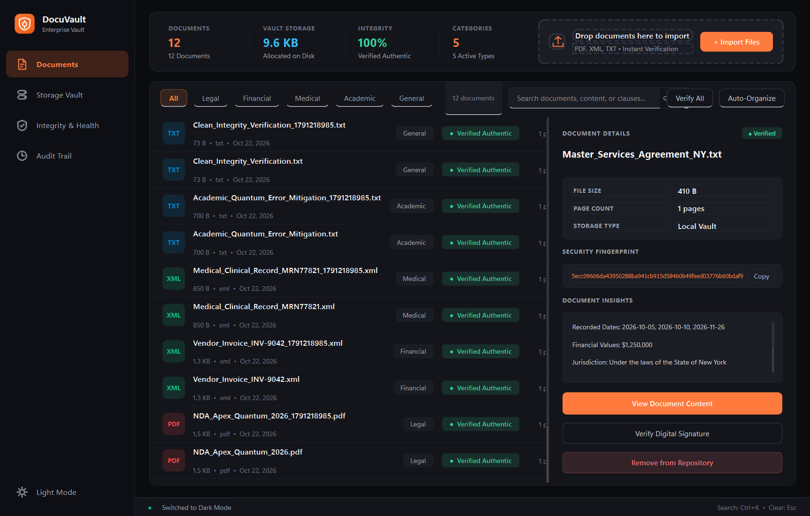
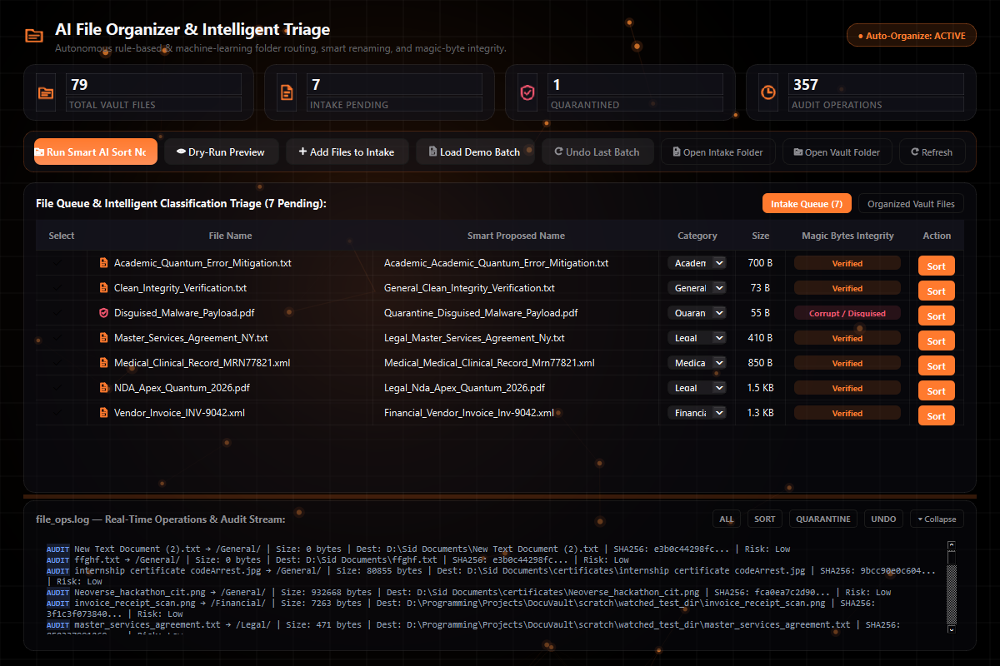
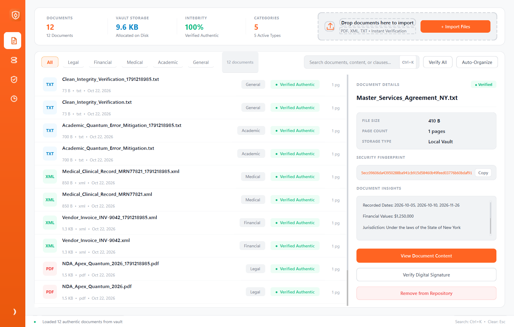
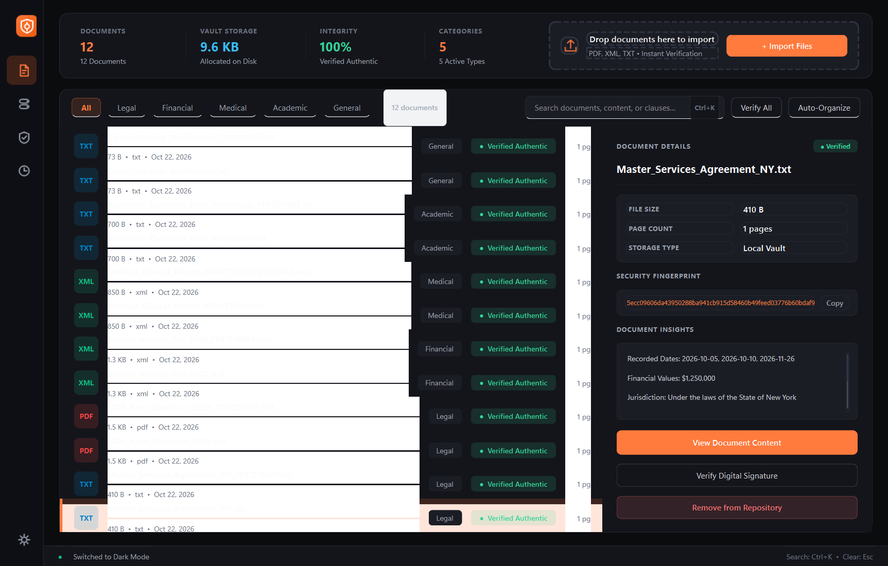
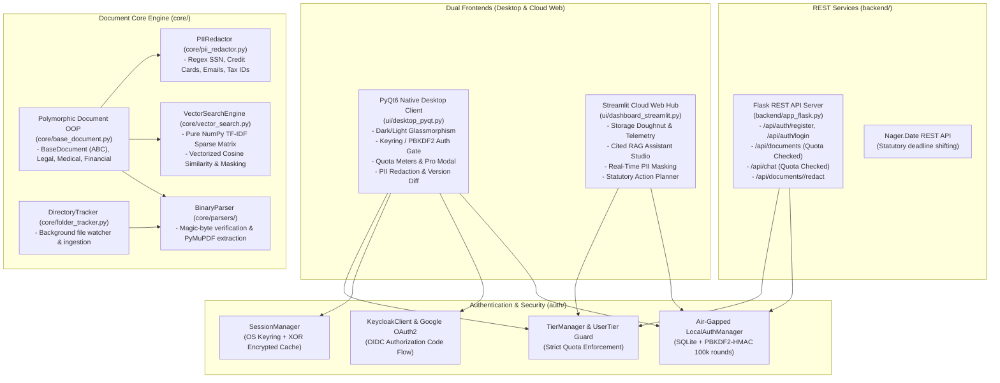

<p align="center">
  
</p>

<h1 align="center">DocuVault</h1>

<p align="center">
  <strong>Multi-Tenant Document Intelligence, Zero-Knowledge Vault & AI Lifecycle Assistant</strong>
</p>

<p align="center">
  <a href="https://github.com/musxsid/DocuVault/actions"></a>
  <a href="https://www.python.org/downloads/"></a>
  <a href="https://riverbankcomputing.com/software/pyqt/"></a>
  <a href="https://streamlit.io/"></a>
  <a href="https://flask.palletsprojects.com/"></a>
  <a href="LICENSE"></a>
  <a href="docs/"></a>
</p>

---

## 🌟 Overview

**DocuVault** is an enterprise-grade, offline-first document intelligence platform engineered for zero-knowledge privacy, verifiable integrity, and automated document lifecycle management. 

Featuring a dual-frontend architecture (**PyQt6 Native Desktop Client** and **Streamlit Cloud Web Hub**) powered by a **Flask REST microservices backend**, DocuVault allows individuals and organizations to securely ingest, inspect, sanitize, and query unstructured documents (PDF, XML, TXT, DOCX) without risk of data exfiltration.

```
                    ┌────────────────────────────────────────────────────────┐
                    │                      DocuVault                         │
                    └────────────────────────────────────────────────────────┘
                                   │                           │
                   ┌───────────────▼──────────────┐   ┌────────▼────────────────┐
                   │  Native PyQt6 Desktop GUI    │   │  Streamlit Cloud Web    │
                   │  (Dark/Light Glass Morphism) │   │  (Interactive Analytics)│
                   └───────────────┬──────────────┘   └────────┬────────────────┘
                                   │                           │
                                   └───────────────┬───────────┘
                                                   │
                       ┌───────────────────────────▼───────────────────────────┐
                       │          Flask REST Services & Core Engine            │
                       │  - Magic-Byte Binary Parser    - SHA-256 Verification │
                       │  - Pure NumPy TF-IDF Search    - Regex PII Redactor   │
                       │  - Multi-Tenant Tier Gating    - Statutory Deadlines  │
                       └───────────────────────────────────────────────────────┘
```

---

## 📸 Interface Preview

<div align="center">
  <table>
    <tr>
      <td width="50%">
        
        <p align="center"><em>Main Document Workspace &amp; Inspection (Dark Mode)</em></p>
      </td>
      <td width="50%">
        
        <p align="center"><em>AI File Organizer &amp; Audit Trail Forensic Center</em></p>
      </td>
    </tr>
    <tr>
      <td width="50%">
        
        <p align="center"><em>Adaptive Light Glassmorphism Mode</em></p>
      </td>
      <td width="50%">
        
        <p align="center"><em>Storage Telemetry &amp; SHA-256 Health Meter</em></p>
      </td>
    </tr>
  </table>
</div>

---

## ⚡ Core Features

### 🔒 1. Zero-Knowledge Air-Gapped Security & Binary Forensics
- **Magic-Byte Header Validation:** Discards malicious extension-spoofed binaries (e.g., `.exe` disguised as `.pdf`) by inspecting low-level magic numbers (`%PDF-`, `PK\x03\x04`, `<?xml`).
- **Cryptographic Tamper-Evidence:** Calculates and monitors streaming chunked **SHA-256 hashes** to ensure stored files remain completely uncorrupted and authentic.
- **Automated Quarantine:** Flagged or polyglot payloads are instantly isolated in `vault/quarantine/` with execution privileges stripped.

### 🤖 2. Offline-First Neural RAG & Explainable AI Assistant
- **First-Principles TF-IDF Retrieval:** High-performance vectorized search implemented purely in **NumPy** using cosine similarity dot-products and boolean masking.
- **Anti-Hallucination Guardrails:** Every response is bound strictly to indexed corpus chunks and provides exact source metadata: document title, target page number, and cited verbatim clauses.
- **Hybrid Cloud Fallback:** Integrates high-speed **Groq LLM** synthesis when internet connectivity is active, and seamlessly falls back to 100% air-gapped local retrieval when offline.

### 🛡️ 3. High-Precision PII Detection & Automated Redaction
- **Automated Masking:** Scans contracts and medical records for sensitive entities (Social Security Numbers, Credit Cards, Corporate Tax IDs, Phone Numbers, and Emails) using optimized regular expression automata.
- **Irreversible Masking:** Generates sanitized copies with redacted black-box blocks while preserving document syntax and structure.

### 👥 4. Multi-Tenant Two-Tier Subscription Architecture
- **Self-Service Subscriptions:** Direct, friction-free registration supporting both **Free Trial** and **Pro / Upgraded Plans** without administrative bottlenecks.
- **Enterprise SSO & Local Fallback:** Supports **Keycloak OIDC**, **Google OAuth2 SSO** (via system browser callback on `http://localhost:8088/callback`), and an air-gapped **PBKDF2-HMAC (100,000 rounds)** local database with OS keyring session caching.

### 📅 5. Statutory Deadline Calculator & Calendar Export
- **Public Holiday Shifting:** Evaluates contract milestones (payment notices, NDA expirations, indemnity clauses) against public holidays via the **Nager.Date REST API**, automatically bumping deadlines landing on non-business days to the next working day.
- **iCalendar (.ics) Integration:** 1-click export of verified milestones to Google Calendar, Apple Calendar, or Microsoft Outlook.

### 📁 6. Background Folder Tracking & Smart Categorization
- **Reactive Directory Watcher:** Background thread monitors designated system folders and automatically ingests new files.
- **Categorical Sorter:** Routes documents into categorized namespaces (`/Legal`, `/Financial`, `/Medical`, `/Academic`, `/General`) with an append-only `file_ops.log` audit trail.

---

## 💎 Two-Tier Subscription Model

| Capability | 🆓 Free Trial Plan | ⚡ Pro / Upgraded Plan |
| :--- | :--- | :--- |
| **Document Storage Limit** | Up to **5 Documents** | **Unlimited Documents & Folders** |
| **AI RAG Queries** | **10 Queries** per session | **Unlimited Queries & Fast OCR** |
| **Storage Architecture** | Air-Gapped Local Storage | **Zero-Knowledge Cloud Sync & Web Hub** |
| **Smart Document Diff** | 🔒 Locked (Upgrade required) | **Full Version History & Side-by-Side Visual Diff** |
| **Automated PII Redaction** | 🔒 Locked (Upgrade required) | **Batch Regex PII Redaction & Export** |
| **Calendar Expiry Export** | 🔒 Locked (Upgrade required) | **RFC 5545 iCalendar (`.ics`) Export** |
| **UI Badge Indicator** | `[FREE TIER]` Charcoal Badge | `[PRO PLAN]` Radiant Electric Blue Badge |

---

## 🏛️ System Architecture



---

## 🚀 Quickstart Guide

### 1. Prerequisites
- **Python 3.10+** (Tested on Python 3.10, 3.11, and 3.14)
- **Git**

### 2. Clone and Setup Environment

```bash
# Clone the repository
git clone https://github.com/musxsid/DocuVault.git
cd DocuVault

# Create and activate virtual environment
python -m venv .venv

# Windows
.venv\Scripts\activate

# Linux / macOS
source .venv/bin/activate

# Install dependencies
pip install -r requirements.txt
```

### 3. Configure Environment Variables

```bash
# Copy template configuration
cp .env.example .env
```
*(Optional)* Add your **Groq API key** to `.env` to enable cloud LLM synthesis. When omitted, DocuVault operates seamlessly using offline TF-IDF vector ranking.

### 4. Running the Applications

DocuVault features a unified launcher (`run.py`):

```bash
# Launch Native PyQt6 Desktop Application (Default)
python run.py --desktop

# Launch Flask REST API + Streamlit Cloud Web Hub
python run.py --web

# Launch Flask REST API microservice independently (Port 5000)
python run.py --backend

# Generate realistic test documents (Legal NDA, Invoice, Medical Record)
python run.py --samples

# Execute automated background file sorter on intake folder
python run.py --sort

# Run comprehensive automated test suite (52 tests)
python run.py --test
```

---

## 📡 REST API Reference

The Flask microservices server (`backend/app_flask.py`) provides authenticated REST endpoints:

| Method | Endpoint | Description | Tier Access |
| :--- | :--- | :--- | :--- |
| `POST` | `/api/auth/register` | Register a new user account | Public |
| `POST` | `/api/auth/login` | Authenticate with credentials or SSO | Public |
| `POST` | `/api/auth/upgrade` | Upgrade current user to Pro tier | Authenticated |
| `GET` | `/api/auth/profile` | Retrieve user profile & quota utilization | Authenticated |
| `POST` | `/api/documents/upload` | Ingest and categorize a document | Free (≤ 5 docs) / Pro (Unlimited) |
| `POST` | `/api/chat` | Query vault documents using TF-IDF RAG | Free (≤ 10 queries) / Pro (Unlimited) |
| `POST` | `/api/documents/<id>/redact` | Execute regex PII redaction on target doc | ⚡ Pro Only |
| `GET` | `/api/documents/<id>/diff` | Generate side-by-side clause version diff | ⚡ Pro Only |
| `GET` | `/api/documents/analytics` | Compute category distribution & health scores | Authenticated |

---

## 📂 Project Directory Structure

```
DocuVault/
├── .github/
│   └── workflows/
│       └── ci.yml               # Automated CI test discovery pipeline
├── assets/
│   ├── favicon.ico              # Application taskbar & window icon
│   ├── favicon.png              # High-res application icon
│   ├── logo.png                 # Primary DocuVault emblem
│   ├── presentation/            # Architectural and diagnostic diagrams
│   └── screenshots/             # High-resolution application preview captures
├── auth/
│   ├── keycloak_client.py       # Keycloak OIDC & Google OAuth2 SSO client
│   ├── local_auth.py            # Air-gapped PBKDF2-HMAC SQLite authentication
│   ├── session_manager.py       # OS keyring & encrypted fallback session cache
│   └── tier_manager.py          # Two-tier quota enforcement & @require_pro guard
├── backend/
│   ├── api_client.py            # Python HTTP client for Flask REST endpoints
│   └── app_flask.py             # Flask REST API server & routing
├── config/
│   ├── api_keys.json.example    # API keys configuration template
│   └── settings.json            # Initial desktop preferences (theme, onboarding)
├── core/
│   ├── parsers/
│   │   ├── binary_parser.py     # Magic-byte format validator (%PDF, PK, XML)
│   │   ├── pdf_parser.py        # PyMuPDF chunked stream extraction engine
│   │   └── xml_parser.py        # Structured XML schema extraction
│   ├── ai_assistant.py          # Grounded AI assistant with citation guardrails
│   ├── base_document.py         # Abstract Base Document classes (OOP Hierarchy)
│   ├── batch_exporter.py        # Comprehensive dossier & batch ZIP exporter
│   ├── catalog_manager.py       # Pandas MultiIndex document catalogue
│   ├── deadlines.py             # Statutory deadline engine & holiday shifting
│   ├── duplicate_detector.py    # difflib near-duplicate contract clause diff
│   ├── folder_tracker.py        # Real-time directory watcher & ingestion
│   ├── health_score.py          # SHA-256 cryptographic health score forensics
│   ├── ocr_engine.py            # High-speed Windows native OCR engine
│   ├── organizer.py             # Categorical sorting daemon & audit logger
│   ├── pii_redactor.py          # Regular expression PII detection & masking
│   ├── storage_providers.py     # Local air-gapped storage & cloud mirror
│   └── vector_search.py         # Pure NumPy TF-IDF matrix & cosine ranking
├── docs/
│   ├── DocuVault_Comprehensive_Architecture_and_Use_Cases_Report.pdf
│   ├── DocuVault_Presentation.pdf
│   ├── DocuVault_Presentation.pptx
│   └── DocuVault_Project_Report_Synopsis.pdf
├── keycloak_theme/              # Custom Deep Slate Keycloak theme templates
├── scripts/
│   ├── build_academic_report.py # ReportLab technical synopsis compiler
│   ├── generate_pdf_report.py   # Comprehensive architecture report generator
│   └── generate_presentation.py # Executive widescreen presentation builder
├── tests/                       # Automated unit & integration test suite (52 tests)
│   ├── test_units.py
│   ├── test_phase1_auth_and_tiers.py
│   ├── test_phase4_end_to_end.py
│   ├── test_phase5_production_features.py
│   ├── test_startup_animation.py
│   └── test_features_and_mongo.py
├── ui/
│   ├── components/              # Modular UI dialogs (Onboarding, Login, Splash)
│   ├── dashboard_streamlit.py   # Streamlit Cloud Analytics Web Hub
│   ├── desktop_pyqt.py          # PyQt6 Enterprise Desktop Application
│   └── feature_dialogs.py       # Dialogs for PII Redaction, Diff, Dossier
├── vault/
│   ├── Academic/                # Academic research papers & preprints
│   ├── Financial/               # Vendor invoices & financial spreadsheets
│   ├── General/                 # General documentation & notes
│   ├── Legal/                   # NDAs, Master Service Agreements & contracts
│   ├── Medical/                 # Clinical records & HIPAA compliance forms
│   ├── intake/                  # Drop folder for incoming raw documents
│   ├── plots/                   # Dynamic runtime similarity plots
│   └── quarantine/              # Isolated quarantine for corrupted/spoofed files
├── .env.example                 # Environment variables specification
├── .gitignore                   # Production git exclusion specifications
├── generate_samples.py          # Realistic sample document generator
├── LICENSE                      # MIT Open Source License
├── requirements.txt             # Production dependencies
├── README.md                    # Project documentation
└── run.py                       # Unified system CLI launcher
```

---

## 🧪 Comprehensive Automated Testing

DocuVault features **52 automated unit and integration tests** covering every core subsystem:

```bash
python -m unittest discover tests -v
```

### Test Suite Highlights:
- **`tests/test_units.py` (22 tests):** OOP hierarchy, binary magic-byte detection, regex contract extraction, public holiday date arithmetic, Pandas MultiIndex catalog manipulation, pure NumPy TF-IDF matrix math.
- **`tests/test_phase1_auth_and_tiers.py` (10 tests):** Salted PBKDF2-HMAC password hashing, offline Keycloak OIDC fallback, token caching, encrypted local session persistence, onboarding flags.
- **`tests/test_phase4_end_to_end.py` (8 tests):** Self-service registration, instant Pro plan upgrade, regex PII redaction, Free vs. Pro quota enforcement, Flask REST tier status codes (403 Forbidden).
- **`tests/test_phase5_production_features.py` (4 tests):** AI Assistant Groq fallback, OCR extraction, version diffing, and batch exports.
- **`tests/test_startup_animation.py` (3 tests):** Single-window PyQt6 splash transitions, lifecycle event handlers, and user authentication signals.
- **`tests/test_features_and_mongo.py` (5 tests):** MongoDB real-time persistence fallback, audit logging, and category classification.

---

## 🎨 Enterprise Design System

DocuVault's visual identity uses clean, high-contrast tokens engineered for prolonged analytical work:

- **Canvas Background:** `#08080C` (Pure Obsidian Dark) / `#F8FAFC` (Clean Slate Light)
- **Card Surface:** `#14141E` / `#FFFFFF`
- **Brand Electric Orange:** `#FF7A2E` (Accent Highlight & Badges)
- **Pro Tier Radiant Blue:** `#2563EB` (Pro Subscription Elements)
- **Verified Status Green:** `#10B981` (Cryptographic Pass Indicators)
- **Quarantine Alert Red:** `#EF4444` (Corrupted / Spoofed Binaries)
- **Border Grayscale:** `#262634` / `#E2E8F0`

---

<details>
<summary><strong>📜 Advanced Academic Curriculum Compliance (Units 1 - 5)</strong></summary>

<br/>

DocuVault strictly implements all pedagogical requirements across Units 1 to 5 of the Advanced Python Curriculum:

| Curriculum Unit | Core Architectural Module | Implementation in DocuVault |
| :--- | :--- | :--- |
| **Unit 1: OOP & GUI** | `core/base_document.py`, `ui/desktop_pyqt.py`, `core/pii_redactor.py` | `BaseDocument` ABC, `DocumentFactory`, custom tier exceptions (`TierLimitExceededError`, `FeatureLockedError`), regex PII redaction automata, `QPropertyAnimation`, `QThread` workers. |
| **Unit 2: APIs & Security** | `auth/keycloak_client.py`, `auth/session_manager.py`, `backend/api_client.py` | Keycloak OIDC password grant, Google OAuth2 system callback on port 8088, OS keyring credential storage, Nager.Date holiday API calculations, `file_ops.log` audit logging. |
| **Unit 3: Web Frameworks** | `backend/app_flask.py`, `ui/dashboard_streamlit.py` | Flask REST API microservices with HTTP status handlers (403, 401, 400), Streamlit analytics dashboard with real-time tier meters and PII studio. |
| **Unit 4: Parsers & Pandas** | `core/parsers/binary_parser.py`, `core/catalog_manager.py` | Magic-byte binary verification (`%PDF`, `PK`, `<?xml`), streaming PyMuPDF extraction, SHA-256 chunked hashing, Pandas MultiIndex catalogue with imputation. |
| **Unit 5: NumPy & Viz** | `core/vector_search.py` | Pure NumPy TF-IDF matrix computation, vectorized cosine dot-products, boolean masking filters, Matplotlib similarity distribution plots. |

</details>

---

## 📄 Documentation & Reports

Detailed technical documentation and academic publications are archived in the [`docs/`](docs/) directory:
- 📑 [**DocuVault Comprehensive Architecture and Use Cases Report**](docs/DocuVault_Comprehensive_Architecture_and_Use_Cases_Report.pdf) — Complete architectural whitepaper, threat model, and technical specifications.
- 📊 [**DocuVault Executive Presentation (PDF)**](docs/DocuVault_Presentation.pdf) / [**(PPTX)**](docs/DocuVault_Presentation.pptx) — 13-slide executive presentation in signature 16:9 widescreen dark mode.
- 📝 [**DocuVault Project Report & Technical Synopsis**](docs/DocuVault_Project_Report_Synopsis.pdf) — Formal academic synopsis formatted to standard university specifications.

---

## 🤝 Contributing

Contributions, bug reports, and suggestions are welcome!
1. Fork the Project: `git checkout -b feature/AmazingFeature`
2. Commit your Changes: `git commit -m 'feat: add some AmazingFeature'`
3. Push to the Branch: `git push origin feature/AmazingFeature`
4. Open a Pull Request

---

## 📄 License

Distributed under the **MIT License**. See [`LICENSE`](LICENSE) for complete details.

Copyright &copy; 2026 **Siddharth Shakya ([@musxsid](https://github.com/musxsid))**. All rights reserved.
